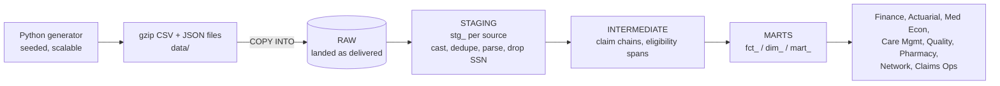
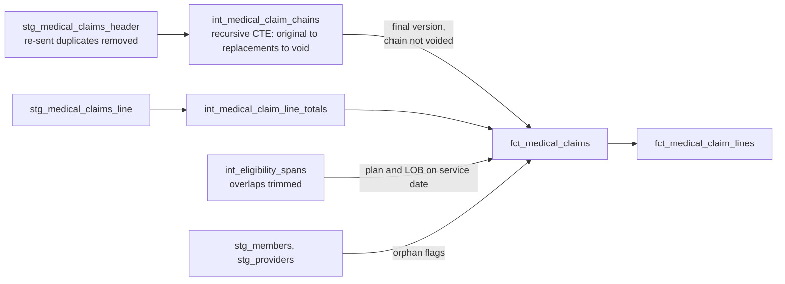

# Pacific Crest Health: healthcare claims analytics engineering

An end-to-end analytics engineering project on synthetic payer data: messy raw extracts land in Snowflake, and dbt turns them into trusted claims, cost, utilization and quality marts for eight stakeholder teams.



Pacific Crest Health is fictional: Medicaid, Commercial and Medicare Advantage members in CA, NV and AZ, January 2024 through June 2026.

## What's in the repo

| Folder | What it is | Status |
| --- | --- | --- |
| `generator/` | Seeded Python generator with realistic, documented data problems | Done |
| `data/` | Sample extract at scale 0.1 (~800k rows, 24 MB) | Done |
| `dbt/models/staging/` | One `stg_` model per source: cleanup, dedupe, date parsing, SSN dropped | Done |
| `dbt/models/intermediate/` + `marts/fct_medical_claim*` | AE-101 claim of record, worked end to end as the example | Done |
| `dbt/models/marts/` other files | AE-102 to AE-108 and dims, as disabled stubs with hints | **Yours to build** |
| `dbt/tests/` | Singular tests for chain resolution, overlaps, date parsing, PHI | Done for AE-101 |

## 1. Load the data into Snowflake (you do this part)

The dbt sources expect this contract:

- Database `HEALTH_DEV`, schema `RAW` (override with env vars `PCH_RAW_DATABASE`, `PCH_RAW_SCHEMA`)
- One table per folder in `data/`, named after the folder
- **CSV tables:** every column `VARCHAR`, column names exactly as the CSV header. Landing raw as text is deliberate: all typing and cleanup happen in staging, so a bad value never fails a load
- **`pharmacy_claims`:** a single `VARIANT` column named `RAW_RECORD`, one row per JSON line
- Load both the normal files and the `*_resend_*` files; the duplicates are part of the exercise

Pointers for doing it yourself: a named CSV file format (`SKIP_HEADER = 1`, `FIELD_OPTIONALLY_ENCLOSED_BY = '"'`, `EMPTY_FIELD_AS_NULL = TRUE`), a JSON file format, an internal stage per source, `PUT` from SnowSQL, then `COPY INTO`. `INFER_SCHEMA` can save typing the column lists. Use an X-Small warehouse with auto-suspend at 60 seconds.

Want more data? `cd generator && python generate.py --scale 1.0 --out ../data` makes ~8M rows.

## 2. Run dbt

Requires dbt Core 1.10+ with the Snowflake adapter.

```bash
pip install "dbt-snowflake>=1.10"
cp dbt/profiles.yml.example ~/.dbt/profiles.yml   # then set SNOWFLAKE_ACCOUNT / USER / PASSWORD env vars
cd dbt
dbt deps
dbt source freshness
dbt build              # runs models and tests in dependency order
dbt docs generate && dbt docs serve
```

`dbt build` should finish green with one warning: `warn_header_line_paid_mismatch` lists the ~0.5% of claims where the header paid doesn't tie to the lines. That's a known source issue, flagged for Claims Operations rather than hidden.

## 3. The tickets

Full stakeholder requirements are in the project doc. Short version:

| Ticket | Stakeholder | Deliverable | Status |
| --- | --- | --- | --- |
| AE-101 | Claims Operations | `fct_medical_claims`, `fct_medical_claim_lines` | Built (worked example) |
| AE-102 | Finance | `fct_member_months`, `mart_pmpm_monthly` | Stub |
| AE-103 | Actuarial | `mart_claims_lag_triangle` | Stub |
| AE-104 | Medical Economics | `mart_utilization_monthly` | Stub |
| AE-105 | Care Management | `mart_care_mgmt_outreach` | Stub |
| AE-106 | Quality | `mart_quality_hba1c` | Stub |
| AE-107 | Pharmacy | `fct_pharmacy_claims`, `mart_pharmacy_monthly` | Stub |
| AE-108 | Network Management | `dim_provider`, `mart_provider_scorecard` | Stub |
| Dims | Shared | `dim_member`, `dim_plan`, `dim_date` | Stub |

To start a stub: open the file, read the hints, delete the `{{ config(enabled=false) }}` line, write the SQL, add it to `models/marts/_marts.yml` with tests.

Suggested order: dims → AE-102 → AE-104 → AE-107 → AE-103, AE-105, AE-106, AE-108.

## How AE-101 works



Decisions worth knowing (and copying the habit of writing down):

- **Claim of record = the deepest version in a chain.** Replacements point at the version they change, so the chain is walked with a recursive CTE. If the latest version is a void, the whole chain drops out.
- **Amounts come from the lines.** The header paid amount is kept as `header_paid_amt` so mismatches can be reconciled.
- **Flag, don't drop.** Orphan members and providers, claims outside eligibility, future dates and negative allowed amounts are `is_*` / `has_*` flags, with `has_any_dq_issue` as a rollup. Finance can exclude them; Claims Ops can work them.
- **Overlapping eligibility:** the earlier span ends the day before the later one starts, so every claim maps to at most one span.
- **PHI:** SSN is dropped in staging. Marts carry only `member_sk` (an MD5 of member_id), enforced by `tests/assert_no_phi_in_marts.sql`.

On the 0.1 sample, 178k raw header rows resolve to about 165k claims of record. The difference is re-sent duplicates, superseded versions and voided chains.

## Portfolio checklist

- [ ] All tickets built, `dbt build` green
- [ ] Lineage graph screenshot from `dbt docs` in this README
- [ ] A decisions log for each ambiguous rule you chose (member-month rule, ER visit logic, readmission window)
- [ ] One or two Snowsight dashboards on the PMPM and utilization marts
